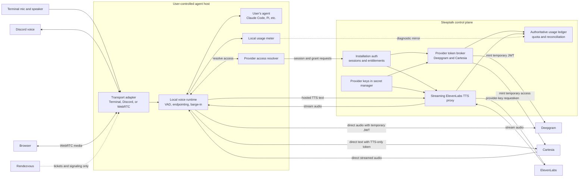

# ADR 0002: Hybrid provider access for hosted Sleeptalk credits

Date: 2026-08-20
Status: Proposed (strategic scope amended 2026-08-20; see Relationship to
Roadmap 2.0)

## Relationship to Roadmap 2.0

Roadmap 2.0 is the canonical roadmap. It establishes a provider-neutral
runtime and an eventual realtime-infrastructure marketplace as long-term
company goals. This ADR decides only the **MVP** provider-access topology:
the hybrid direct-token/proxy design, credential safety, attribution, and
billing requirements below remain controlling for the MVP and for hosted
alpha. The marketplace is a later, separately decided expansion of supply on
top of these same access, catalog, and ledger primitives — not a reversal of
this decision. Where this ADR earlier read as forbidding that marketplace
outright, the non-goal is now scoped to the MVP (see Non-goals).

## Executive decision

Sleeptalk should present two product modes while using three provider-access
mechanisms internally:

1. **Use Sleeptalk credits** is the default hosted experience. The user signs
   in once and never handles speech-provider keys.
2. **Bring your own keys** remains the self-hosted and advanced experience.
   Provider traffic goes directly from the bot host to the provider.
3. Hosted traffic is **hybrid**, chosen per provider capability:
   - Deepgram STT remains direct using a short-lived provider token brokered by
     Sleeptalk, provided the Phase 0 attribution and abuse-containment gates
     pass.
   - Cartesia TTS remains direct using a short-lived, TTS-only Cartesia access
     token, subject to the same hosted-billing attribution gate.
   - ElevenLabs TTS is **BYOK-only at hosted-alpha launch** (operator
     decision 2026-08-21, recorded under `r2-decision-region` notes).
     ElevenLabs offers short-lived delegation only for conversational
     endpoints; standard TTS has no delegable credential, so no hosted proxy
     is built unless one ships. The narrow-proxy design below is retained as
     the pre-approved topology if that changes.
   - Surface media, endpointing, barge-in, and the user's agent stay on the
     agent host in both modes. This applies to Terminal/local mic, native
     Discord, and browser calls through Rendezvous.

The user chooses who pays, not a network topology. `direct`, `brokered`, and
`proxied` are implementation details resolved at runtime.

| Path | Proposed hosted route | Required proof | Fallback if proof fails |
|---|---|---|---|
| Surface transport | Direct to agent host | Existing behavior | None; never route it through the speech proxy |
| Deepgram STT | Direct with temporary JWT | Immutable account attribution and bounded token abuse | Proxy STT |
| Cartesia TTS | Direct with temporary TTS-only token | Authoritative account attribution and bounded token abuse | Proxy Cartesia TTS |
| ElevenLabs TTS | Streaming Sleeptalk proxy | Latency, cancellation, and zero-content-log gates | BYOK only until fixed |
| User's agent | Local/direct | Existing adapter behavior | None; outside hosted speech billing |

Cartesia is the preferred first hosted-TTS proof because it requires only the
token broker and preserves the existing direct streaming path. That is an
operational sequencing choice, not a voice-quality judgment and not a change
to DeepRe's gold-standard ElevenLabs configuration.

This is not approval to build a general media gateway in the MVP. It is a
proposal for a small control plane and one provider-specific proxy,
introduced behind the existing provider adapter seam. The long-term
provider-neutral marketplace remains a Roadmap 2.0 goal and is out of scope
for this decision.

## Context

DeepRe is the gold-standard reference configuration. Today its native Discord
and Web URL paths run from the operator's Mac:

- Discord voice and browser WebRTC media terminate locally.
- local VAD, endpointing, and barge-in own the conversation loop;
- Deepgram receives audio directly over a WebSocket;
- Claude Code runs as a local subprocess; and
- ElevenLabs receives TTS requests directly over HTTP.

The Web URL's Rendezvous service relays ticketing and WebRTC signaling, not
speech audio or provider traffic. There is no Sleeptalk-owned speech service in
these call paths. The current Discord topology and preliminary measurements
are documented in
the DeepRe runtime audit (internal).

BYOK is safe because the operator supplies and pays for their own provider
keys. Hosted credits create a different problem: a permanent Sleeptalk
provider key cannot be placed on a user-controlled bot host. A user could
extract it and spend outside Sleeptalk's product controls.

Provider capabilities differ:

- Deepgram explicitly supports short-lived JWTs for untrusted, latency-
  sensitive clients. A token is needed only when the WebSocket connects, and
  the connection can outlive the token.
- Cartesia supports short-lived client access tokens with granular TTS, STT,
  and agent grants. A hosted Cartesia route can therefore issue a TTS-only
  token and preserve the current direct streaming WebSocket.
- ElevenLabs' general TTS flow currently uses API keys. Restricted keys and
  credit limits reduce blast radius, but they are still permanent account
  credentials and must not be distributed to bot hosts.

The architecture must hide those differences without adding a server hop to
every realtime connection.

## Goals

- One-command hosted onboarding with no speech-provider keys.
- Preserve the current direct Deepgram WebSocket and local voice behavior.
- Never expose a permanent Sleeptalk provider credential to a bot host.
- Make hosted usage attributable, reconcilable, capped, and revocable.
- Keep BYOK functional when Sleeptalk's service is unavailable.
- Reuse the provider registries, metering seam, and configurable base URLs.
- Avoid storing prompts, transcripts, or audio as a consequence of billing.
- Allow another provider to declare its access strategy without changing the
  session builder.

## Non-goals

- Proxying Discord voice or owning Discord bot tokens.
- Proxying Claude Code or billing for the user's agent/model usage.
- Moving VAD, endpointing, turn detection, or barge-in to a server.
- Building a general OpenRouter-style gateway for every speech provider in
  the MVP. (The long-term provider-neutral marketplace is a Roadmap 2.0
  goal, not a non-goal; this ADR only rules it out of the MVP topology
  decided here.)
- Selecting final retail prices before real usage distributions exist.
- Replacing BYOK.

## Product surfaces in scope

Hosted provider access is a runtime capability beneath transports, not a
Discord feature. The same profile, provider adapters, access resolver, usage
meter, and agent are reused by all three initial surfaces:

| Surface | Media path | Where STT, agent, and TTS run | Hosted-credential rule |
|---|---|---|---|
| Terminal / local mic | OS microphone and speaker connect to the local process | Agent host | The local runtime resolves temporary or proxied provider access; no surface-specific credential code |
| Native Discord | Discord voice connects directly to the agent host | Agent host | Discord credentials remain local; speech-provider access uses the shared resolver |
| Web URL / Rendezvous | Browser and agent host connect over WebRTC; Rendezvous relays tickets and signaling, while TURN may relay encrypted media when direct ICE fails | Agent host | The host resolves provider access; neither browser, Rendezvous, nor TURN receives a speech-provider credential |

The Terminal/local-mic transport is still a roadmap item, not a shipped
surface. Its adapter must feed and consume the same canonical runtime audio
boundary; it must not construct STT/TTS providers itself. Native Discord and
the Web URL already build their speech resources on the agent host from the
same Sleeptalk profile.

For the Web URL, the browser is an audio input/output client only. The
Rendezvous worker remains outside the provider-access and billing boundary.
Moving STT or TTS into the browser would be a separate architecture decision
and is explicitly not implied by hosted credits.

## Proposed topology



The control plane is necessary for hosted credits, but it is not the voice
runtime or a surface media relay. If it disappears, an established Deepgram
WebSocket continues and BYOK sessions remain unaffected.

## Product modes

### Mode 1: BYOK

```text
bot host --user's Deepgram key-----> Deepgram
bot host --user's Cartesia key-----> Cartesia
bot host --user's ElevenLabs key---> ElevenLabs
```

- Existing `.env` credential loading remains supported.
- Existing provider `base_url` overrides remain available.
- Sleeptalk does not charge for provider usage.
- Local metering remains useful for diagnostics and cost estimates.
- No Sleeptalk service is required to start or sustain a call.

### Mode 2: Sleeptalk credits

```text
bot host --Sleeptalk installation auth--> Sleeptalk control plane
bot host --temporary token + audio------> Deepgram
bot host --temporary token + text-------> Cartesia
bot host <--direct streamed audio-------- Cartesia
bot host --text--> Sleeptalk TTS proxy --> ElevenLabs
bot host <--streamed audio--------------- Sleeptalk TTS proxy
```

- The developer signs in once; no Deepgram or ElevenLabs key is requested.
- The bot host stores only a revocable Sleeptalk installation credential.
- A stolen installation credential can consume that account's allowance, but
  cannot access Sleeptalk's provider account or other customers.
- Limits, revocation, and anomaly controls live at the control plane.

## Control-plane responsibilities

The hosted service owns only the responsibilities that cannot safely live on
an untrusted bot host:

| Component | Responsibility |
|---|---|
| Installation auth | Authenticate a bot installation and issue short-lived Sleeptalk session access |
| Entitlements | Decide hosted/BYOK mode, allowed providers, models, voices, concurrency, and remaining credit |
| Route manifest | Tell the runtime whether each operation is direct-static, direct-ephemeral, or proxied |
| Provider token broker | Mint Deepgram or Cartesia client credentials only for an authorized session |
| ElevenLabs proxy | Validate, forward, stream, meter, cancel, and enforce TTS limits |
| Usage ledger | Deduplicate attempts, reconcile provider records, and debit credits |
| Secret storage | Keep provider keys encrypted and unavailable to application logs or bot hosts |

The existing development FastAPI application may host an early spike, but the
production control plane is a separately deployable service boundary. The local
voice runtime must not import it or require the development harness.

## Runtime changes

### 1. Add a provider-access resolver

Adapters currently receive raw keys during registry construction. Replace that
assumption with an asynchronous resolver at the same seam:

```text
resolve(provider, operation, session) ->
    endpoint
    request headers
    expiry
    access mode
    attribution handle
```

Two implementations are sufficient:

- `StaticEnvAccess`: current BYOK behavior.
- `SleeptalkHostedAccess`: obtains the session route, temporary tokens, and
  proxy authorization from the control plane.

Adapters still own provider protocols, formats, and reconnection. They ask the
resolver for access immediately before a real connection or request. This
keeps credential injection at one choke point and naturally supports token
refresh on Deepgram reconnect or REST repair.

### 2. Keep provider configuration separate from payment configuration

The profile continues to choose `deepgram`, `elevenlabs`, models, language, and
voice. The authenticated installation chooses the credential source. A profile
does not need to know that ElevenLabs is proxied in hosted mode.

Hosted routes supplied by Sleeptalk override arbitrary profile base URLs for
hosted-credit operations. BYOK retains custom endpoint freedom.

### 3. Preserve adapter-level metering

The local `UsageMeter` remains attached before each real attempt. It supplies
latency diagnostics, immediate session estimates, and reconciliation signals.
It is not authoritative for billing because the bot host is user-controlled.

## Hosted session and request flows

### Installation and session

1. `sleeptalk login` authenticates the developer and registers an installation.
2. A revocable installation credential is stored in the operating system's
   credential store, with a protected-file fallback for headless hosts.
3. At bot startup, the runtime exchanges it for a short-lived session access
   token and a route manifest.
4. The route manifest contains no provider master keys.

Conceptual response:

```json
{
  "sessionId": "ses_opaque",
  "expiresAt": "...",
  "routes": {
    "stt": {"provider": "deepgram", "mode": "direct_ephemeral"},
    "tts": {"provider": "elevenlabs", "mode": "proxy"}
  },
  "limits": {
    "concurrentCalls": 1,
    "remainingCreditMicrounits": 123456
  }
}
```

Names and wire formats are illustrative; the boundary is the decision.

### Deepgram streaming STT

1. Before initial WebSocket connect, the runtime requests a Deepgram grant for
   its hosted session.
2. The broker checks account status, concurrency, quota, and session binding.
3. The broker calls Deepgram `/v1/auth/grant` with a server-held key and returns
   the short-lived JWT.
4. The runtime connects directly to Deepgram using `Authorization: Bearer`.
5. Audio never crosses Sleeptalk infrastructure.
6. On reconnect, the runtime requests a fresh token. An existing socket does
   not refresh merely because the bootstrap token expired.
7. A health-gated REST repair request obtains a fresh token immediately before
   that request rather than reusing an expired bootstrap token.

Deepgram says temporary tokens default to 30 seconds, can be extended up to one
hour, work for streaming and REST `/listen`, and retain the accessor of the key
used to mint them. The MVP uses the short default lifetime; longer tokens add
risk without improving established WebSocket stability.

### Cartesia streaming TTS

1. Before opening its TTS WebSocket, the runtime requests a Cartesia grant for
   the hosted session.
2. The broker checks entitlement, quota, and concurrency, then asks Cartesia
   for a short-lived token with `grants: {tts: true}` only.
3. The runtime connects directly to Cartesia using the access token and keeps
   the existing streaming, contexts, cancellation, and audio-chunk behavior.
4. The runtime refreshes access before expiry or obtains a new token when a
   WebSocket must reconnect.
5. Cartesia text and audio never cross Sleeptalk infrastructure.

Cartesia documents client access tokens as the safe alternative to embedding
an API key, supports TTS-only grants, and allows lifetimes up to one hour. Use
the shortest lifetime that does not churn the established socket. Hosted
billing still requires authoritative attribution and a measured abuse bound;
the existence of a granular token solves key exposure, not accounting by
itself.

### ElevenLabs TTS

1. The adapter sends text, approved model/voice fields, output format, session
   ID, and attempt ID to Sleeptalk's ElevenLabs-compatible TTS route.
2. The proxy authenticates the Sleeptalk session, validates entitlement and
   limits, and rejects arbitrary upstream URLs, headers, or models.
3. The proxy starts the metered attempt before calling ElevenLabs.
4. The proxy streams upstream audio bytes to the bot as they arrive. It must
   not buffer the complete provider response.
5. Client cancellation propagates upstream when possible and closes the
   attempt with an explicit status.
6. The proxy records input characters, output bytes, upstream status, and
   timing, but never records the text or audio content.

The current ElevenLabs adapter buffers its HTTP response. Hosted-alpha work
must move it to a streaming response path before proxy latency is evaluated;
otherwise the test would measure two buffering implementations rather than one
network hop.

## Metering and billing

### Trust model

| Source | Use |
|---|---|
| Bot-host meter | Product telemetry, latency, immediate estimate, debugging |
| TTS proxy meter | Authoritative ElevenLabs attempt ledger |
| Deepgram usage API | Authoritative STT reconciliation and per-request cost |
| Cartesia provider records | Authoritative TTS reconciliation only after the attribution gate passes |
| Provider invoices | Financial source of truth |

The bot host may be modified by its operator. Its counters cannot directly
debit money.

Every hosted attempt uses a server-issued opaque `attemptId`. Server APIs are
idempotent on this ID so a network retry cannot create a second debit. The
ledger distinguishes warmups, normal requests, retries, fallbacks,
cancellations, and provider errors.

### Direct-token authorization and attribution gates

Direct temporary tokens protect the permanent key, but they do not by
themselves prove which customer incurred usage. Deepgram reports that a token
retains its generating key's accessor and that key-level tags flow into hosted
usage data. The alpha should provision one tagged Deepgram accessor key per
billing account, retain that key only in the control plane, and mint temporary
tokens from it.

The documented Deepgram JWT grants `usage::write` across several inference
APIs, not only STT, and can be reused during its short lifetime to establish
connections that outlive it. A Sleeptalk record saying “STT” does not make the
provider token STT-only. Phase 0 must establish provider-side concurrency and
spend containment or obtain a narrower platform arrangement. A small prepaid
alpha can accept a deliberately bounded fraud window; public hosted service
cannot assume that 30-second expiry alone caps cost.

Cartesia is narrower because its token can grant TTS without STT or agent
access. Its public documentation does not, by itself, establish immutable
per-customer billing attribution or a per-token spend ceiling. Direct hosted
Cartesia therefore passes through the same proof process rather than trusting
the client meter.

Before hosted alpha, a provider spike must prove all of the following in real
usage exports:

- WebSocket and REST usage minted from an account accessor is attributed to
  that accessor or immutable key tag.
- A client cannot replace or omit the account-level attribution.
- Per-request cost and request IDs can be reconciled automatically.
- Token reuse, cross-endpoint use, revocation, and concurrency controls leave
  an explicitly measured and acceptable fraud window.

Deepgram documents a limit of 250 programmatically created API keys per day.
Per-account accessors are therefore an alpha mechanism, not an assumed
internet-scale design. Before public scale, Sleeptalk must obtain a provider
platform arrangement, validate a scalable accessor model, or proxy STT. If
authoritative direct attribution fails, hosted STT does not launch on trust in
client meters. The same rule applies to direct hosted Cartesia TTS: obtain
provider-grade attribution or proxy it.

### Credit enforcement

- Reserve a conservative maximum before minting a new STT connection or
  starting a TTS request.
- Convert the reservation to actual usage after authoritative reconciliation.
- Release unused reservation on clean failure or cancellation.
- Apply account, installation, IP-risk, and concurrency limits.
- Stop issuing new grants before balance reaches zero; do not terminate an
  established Deepgram socket solely because its bootstrap token expired.
- Alert and revoke on impossible client/server meter divergence.

A direct-token reservation is an accounting control, not a hard provider limit
once a socket exists. Public launch requires the authorization gates above;
the ledger cannot retroactively prevent abusive provider spend.

Prepaid credits are the safest alpha billing model because they cap exposure
while reconciliation is still being proven.

## Security and privacy

- Store provider keys in a managed secret store, encrypted at rest and scoped
  to only the broker/proxy workloads that need them.
- Never include Discord tokens, provider keys, session tokens, request text,
  transcripts, or audio in logs.
- Use short-lived Sleeptalk session access tokens and rotate/revoke the longer-
  lived installation credential.
- Bind Sleeptalk grant records to an account, installation, session, requested
  operation, and concurrency lease. Do not claim that a provider token is more
  narrowly scoped than the provider actually enforces.
- Allowlist provider, model, voice, output format, and request size at the TTS
  proxy. It must not become an arbitrary forwarding proxy.
- Keep content in memory only for the duration of the proxied TTS request.
- Separate billing identifiers from Discord user/guild identifiers.
- Rate-limit token minting separately from provider inference.
- Treat client-reported attempt IDs and counters as untrusted input.

The narrow TTS proxy necessarily sees text and audio in transit. Hosted-mode
terms and product UI must state that fact. BYOK direct mode remains available
for users who require Sleeptalk not to handle content.

## Failure behavior

| Failure | Required behavior |
|---|---|
| Control plane unavailable at startup | Hosted mode fails closed with one actionable message; BYOK still starts |
| Broker unavailable after STT connects | Existing Deepgram socket continues; reconnect waits/retries for a fresh grant |
| Broker unavailable for Cartesia refresh | Current generation completes if the provider permits; new/reconnected TTS waits or uses an explicit fallback |
| TTS proxy unavailable | Use an explicitly configured BYOK fallback or a local cached error clip; never reveal/fall back to a master key |
| Cartesia fails before audio | Meter the failure separately, then use the configured TTS fallback |
| ElevenLabs fails before audio | Retry once only if policy allows and meter it separately, then use the configured TTS fallback |
| Cancellation after audio starts | Stop downstream immediately, attempt upstream cancellation, bill/reconcile actual provider usage |
| Credit exhausted | Refuse new hosted attempts with a stable machine error and a human spoken/text explanation |
| Usage ingest unavailable | Queue diagnostic events locally; authoritative proxy/provider reconciliation continues |
| Meter mismatch | Flag the account/session; do not silently edit the financial ledger from client data |

No automatic fallback from hosted credits to a user's BYOK key occurs unless
the user opted into that exact provider fallback.

## Latency budgets and evaluation

The clean five-turn DeepRe baseline was:

| Measurement | p50 | p95 |
|---|---:|---:|
| Mic onset to first STT partial | 1,027 ms | 1,091 ms |
| Agent request to first text | 9,089 ms | 12,808 ms |
| ElevenLabs request to first audio | 1,035 ms | 1,290 ms |

The sample is enough to choose the architecture direction, not enough to price
or set a durable SLO.

- Deepgram token minting happens before socket connection and adds no hop to
  steady-state audio.
- Cartesia token minting also stays outside generation once a healthy direct
  WebSocket exists; measure startup/refresh separately from first audio.
- The ElevenLabs proxy is accepted for alpha only if it streams without full-
  response buffering and adds no more than 150 ms at p95 to matched
  request-to-first-audio tests from the same bot-host region.
- Proxy error rate must remain below 0.5% excluding upstream provider errors
  during the trial.
- The decision uses at least 50 normal direct turns plus matched direct/proxy
  TTS samples. Talking normally builds the direct cost and latency baseline;
  only an A/B proxy trial measures proxy overhead.

These are initial release gates, not claims about current performance.

## Rollout plan

### Phase 0: provider proof

- Verify Deepgram token mint, WebSocket lifetime, reconnect, REST repair, and
  authoritative accessor/tag attribution.
- Verify Deepgram token reuse/cross-API scope, account-key provisioning
  limits, provider-side concurrency, spend containment, and revocation.
- Verify Cartesia TTS-only token minting, expiry/refresh, WebSocket reconnect,
  cancellation, authoritative attribution, and spend containment.
- Build a throwaway ElevenLabs streaming relay and measure added first-audio
  latency without changing DeepRe's default route.
- Confirm restricted provider keys allow only required models/operations and
  set hard provider-side spend alerts.

Exit: credential delegation, attribution, cancellation, and latency are proven
with provider records, not inferred from docs.

### Phase 1: runtime credential seam

- Add the provider-access resolver and static-env implementation.
- Characterize existing BYOK behavior so the refactor is behavior-neutral.
- Add hosted route parsing behind a disabled feature flag.
- Preserve `base_url` as the endpoint mechanism beneath the resolver.

Exit: all existing DeepRe/BYOK tests and live behavior remain unchanged.

### Phase 2: minimum control plane

- Installation login and revocation.
- Hosted session/entitlement endpoint.
- Deepgram and Cartesia token broker.
- Streaming ElevenLabs proxy.
- Idempotent attempt ledger, prepaid reservation, and quota enforcement.
- Provider usage reconciliation job.

Exit: a test account can run with no provider keys on the bot host and every
charged attempt reconciles to an authoritative provider record.

### Phase 3: DeepRe hosted dogfood

- Run DeepRe alternately in BYOK/direct and hosted/hybrid mode.
- Run a matched Cartesia hosted-token trial through a disposable reference
  variant without changing DeepRe's default ElevenLabs voice.
- Collect at least 50 turns per comparable route.
- Exercise reconnect, REST repair, TTS cancellation, exhausted credit, proxy
  outage, and fallback behavior.
- Verify that neither telemetry nor service logs contain content or secrets.

Exit: latency/error budgets pass and billed totals reconcile within an agreed
rounding tolerance.

### Phase 4: developer alpha

- `sleeptalk login` plus “Use Sleeptalk credits” as the default setup path.
- “Bring your own keys” as an explicit advanced/self-hosted path.
- Clear account usage, limits, provider attribution, and revocation UI.
- No topology choices exposed to the developer.

Exit: a clean host reaches a speaking bot without creating speech-provider
accounts, while an offline/BYOK install remains possible.

## Acceptance criteria

- No permanent Sleeptalk provider credential appears on the bot host.
- Each surface's transport leg terminates at the agent host; Rendezvous and
  the hosted speech service are never inserted between Terminal, Discord, or
  the browser and that host. Provider legs beyond the host follow the route
  manifest independently.
- The user's agent/model connection does not traverse the hosted speech
  service.
- Terminal/local mic, native Discord, and Web URL sessions obtain speech
  access through the same runtime resolver rather than transport-specific
  credential paths.
- The Web URL's browser, Rendezvous worker, and TURN service never receive a
  Deepgram, Cartesia, or ElevenLabs credential.
- Deepgram audio remains direct in hosted mode unless its authorization or
  attribution gate fails; either failure moves hosted STT to a proxy before
  public launch.
- Cartesia TTS remains direct in hosted mode only while its TTS-only token,
  attribution, and abuse-containment gates pass.
- ElevenLabs audio is streamed through the proxy without whole-response
  buffering.
- BYOK works with the control plane unreachable.
- Every financial debit is backed by the proxy ledger or provider usage data.
- Retries, fallbacks, and warmups are separately visible and never double-
  charged by attempt ID.
- An account can be revoked without rotating a global provider key.
- Hosted balances and concurrency limits bound abuse.
- Logs contain no speech content, generated text, transcripts, audio, or
  credentials.
- The matched proxy latency and error gates pass.

## Alternatives considered

### Full STT and TTS proxy now

Rejected for the MVP. It centralizes control and billing, but puts Sleeptalk in
the high-rate, persistent Deepgram media path, adds a global failure domain,
and forces Sleeptalk to reproduce proven reconnection/backpressure behavior.
Reconsider if direct usage cannot be authoritatively attributed or an
enterprise requirement demands centralized media egress.

### Distribute restricted permanent provider keys

Rejected. Provider restrictions and spend caps reduce damage but do not make a
permanent company credential safe on a user-controlled machine.

### Trust client metering for billing

Rejected. Client metering is valuable telemetry but can be altered, omitted,
or replayed by the operator who controls the host.

### Hosted-only, no BYOK

Rejected. It removes the offline/self-hosted property, increases Sleeptalk's
privacy and uptime obligations, and makes every provider outage a Sleeptalk
support issue.

### BYOK-only

Viable for the current product but not the most developer-friendly default.
It forces every developer to create, fund, secure, and debug multiple provider
accounts before hearing their first conversation.

## Conditions that would justify a full proxy later

- Deepgram cannot provide scalable, immutable per-account attribution for
  temporary-token usage.
- Deepgram temporary tokens cannot be restricted or bounded enough to make the
  residual hosted-credit fraud window acceptable.
- Cartesia cannot provide authoritative customer attribution or an acceptable
  spend bound for its otherwise suitable TTS-only access tokens.
- Real-time quota enforcement must terminate active STT streams immediately.
- Enterprise customers require one controlled egress endpoint.
- Cross-provider routing/failover becomes core product value rather than an
  adapter concern.
- Regional edge capacity and the measured latency budget make the extra media
  hop acceptable.
- Central content processing is explicitly required and consented to.

Until one of those conditions is true, the hybrid path buys the desired UX
and credential safety without turning the MVP into a general media carrier.
The later marketplace grows from these primitives under its own decision,
not by widening this MVP boundary.

## References

- [Deepgram token-based authentication](https://developers.deepgram.com/guides/fundamentals/token-based-authentication)
- [Deepgram usage tagging](https://developers.deepgram.com/guides/fundamentals/tagging-your-usage-data)
- [Deepgram project and multi-client guidance](https://developers.deepgram.com/guides/deep-dives/managing-projects)
- [Cartesia client access-token authentication](https://docs.cartesia.ai/get-started/authenticate-your-client-applications)
- [Cartesia access-token API](https://docs.cartesia.ai/api-reference/auth/access-token)
- [Cartesia TTS endpoint guidance](https://docs.cartesia.ai/use-the-api/compare-tts-endpoints)
- [ElevenLabs API-key authentication](https://help.elevenlabs.io/hc/en-us/articles/14599447207697-How-do-I-authorize-myself-using-an-API-key)
- [OpenRouter OAuth as onboarding inspiration](https://openrouter.ai/docs/guides/overview/auth/oauth)
- [OpenCode provider flexibility as product inspiration](https://opencode.ai/docs/providers)
